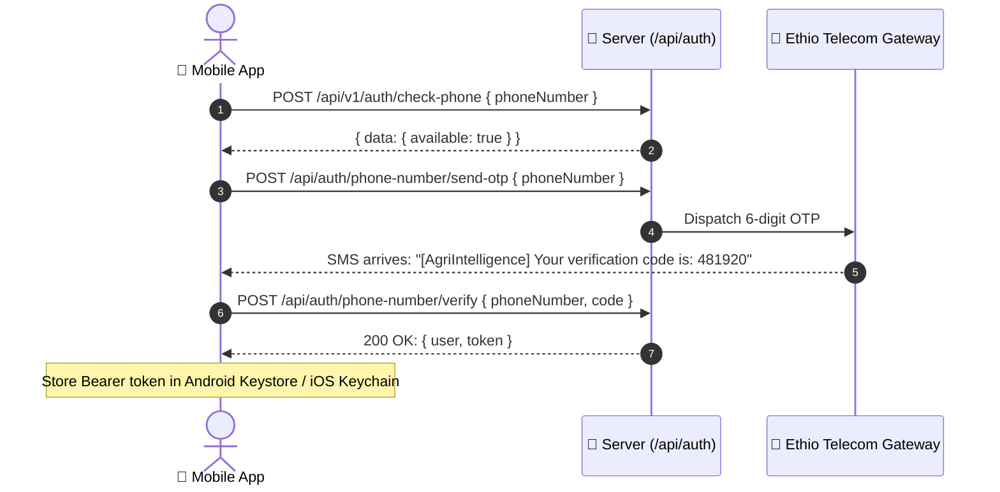
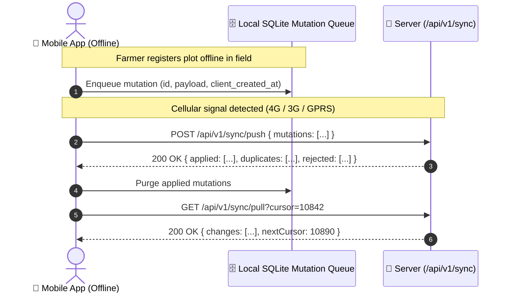

# 📱 AgriIntelligence — Mobile API Contract & Integration Guide

> **Target Audience:** Native Mobile Engineers (React Native / Flutter / Android Kotlin / iOS Swift)  
> **Platform Version:** API v1.3 • High-Performance Hono Monolith  
> **Active Environments:**
> - **Local Dev (Host Machine):** `http://localhost:5000`
> - **Android Emulator Loopback:** `http://10.0.2.2:5000`
> - **Physical Device (LAN / Wi-Fi):** `http://<YOUR_LAN_IP>:5000`
> - **Staging:** `https://staging-api.agri-intelligence.et`
> - **Production:** `https://api.agri-intelligence.et`

---

## ⚡ Quick Navigation

1. [Protocol Conventions & Global Headers](#1-protocol-conventions--global-headers)
2. [Mobile Role Admission & Security Rules](#2-mobile-role-admission--security-rules)
3. [Authentication & Phone OTP (`/api/auth/*`)](#3-authentication--phone-otp)
4. [Farmer Profile & Onboarding (`/api/v1/farmers/*`)](#4-farmer-profile--onboarding)
5. [DA Field Hub Operations (`/api/v1/farmers/*`)](#5-da-field-hub-operations)
6. [Geo-Centroid & Jurisdiction Resolution (`/api/v1/geo/*`)](#6-geo-centroid--jurisdiction-resolution)
7. [Plot Profiling & Land Inventory (`/api/v1/plots/*`)](#7-plot-profiling--land-inventory)
8. [Crop Rotation & Soil History (`/api/v1/plots/:id/crop-history`)](#8-crop-rotation--soil-history)
9. [Master Catalogs (Crops, Pests, Chemicals) (`/api/v1/catalog/*`)](#9-master-catalogs)
10. [Kebeles & Geographic Boundaries (`/api/v1/kebeles`)](#10-kebeles--geographic-boundaries)
11. [3D Soil Stratum Horizons Visualizer Protocol](#11-3d-soil-stratum-horizons-visualizer-protocol)
12. [Offline Sync & Delta Replication (`/api/v1/sync/*`)](#12-offline-sync--delta-replication)
13. [Standard Error Envelopes & Code Matrix](#13-standard-error-envelopes--code-matrix)

---

## 1. Protocol Conventions & Global Headers

All mobile traffic communicates via standard JSON REST with **Bearer Token** authentication.

### 1.1 Mandatory Request Headers

Every request from the native mobile application **must** include:

```http
Content-Type: application/json
Accept: application/json
Authorization: Bearer <session_token>
X-Client-Type: android
X-Device-Id: 550e8400-e29b-41d4-a716-446655440000
X-App-Version: 1.0.0
Accept-Language: am
Idempotency-Key: 9b1deb4d-3b7d-4bad-9bdd-2b0d7b3dcb6d
```

| Header | Type | When to send | Description / Mobile Rule |
| :--- | :--- | :--- | :--- |
| `Authorization` | `string` | Authenticated calls | `Bearer <token>` issued upon OTP verification or login. Sliding 30-day expiry. |
| `X-Client-Type` | `string` | **All requests** | Send strictly `"android"` or `"ios"`. Enforces mobile admission policy. |
| `X-Device-Id` | `UUIDv4` | **All requests** | Hardware/installation UUID. Persisted in device secure storage. |
| `X-App-Version` | `semver` | **All requests** | Client version (e.g. `1.0.0`) for minimum-version enforcement. |
| `Accept-Language` | `enum` | **All requests** | `'am'` (Amharic), `'om'` (Afaan Oromoo), `'ti'` (Tigrinya), or `'en'` (English). Localizes errors and catalog names. |
| `Idempotency-Key`| `UUIDv4` | All mutations | **Mandatory on `POST`, `PUT`, `PATCH`, `DELETE`**. Prevents double submits during rural network jitter. |

### 1.2 Standard Success Envelope
```json
{
  "data": { ... }
}
```

### 1.3 Standard Paginated List Envelope
```json
{
  "data": [ ... ],
  "total": 128,
  "page": 1,
  "limit": 50,
  "totalPages": 3
}
```

---

## 2. Mobile Role Admission & Security Rules

> ⚠️ **Important Security Rule (`MOB-3`):**  
> The mobile client admits only two user roles:
> - 🧑‍🌾 **`farmer`**: Self-onboarded smallholder managing their own parcels.
> - 🧑‍💼 **`da`**: Field Development Agent managing smallholders within their kebele jurisdiction.
>
> If an `officer` or `system_admin` signs in via the mobile app (`X-Client-Type: android`), the backend rejects the session with **`403 Forbidden` (`code: client_not_permitted`)**. Display a screen directing municipal officers to the Web Portal.

---

## 3. Authentication & Phone OTP

Authentication is powered by **Better Auth** with the SMS Phone Number plugin, optimized for Ethiopian telecommunications (`+251 9...` / `+251 7...`).



---

### 3.1 Check Phone Availability
Check if a phone number is already registered before beginning onboarding.

- **Endpoint:** `POST /api/v1/auth/check-phone`
- **Auth:** Public
- **Request Body:**
```json
{
  "phoneNumber": "+251911223344"
}
```
- **Response (200 OK):**
```json
{
  "data": {
    "available": true
  }
}
```

---

### 3.2 Request Phone OTP (Registration or Passwordless Login)
Dispatches a 6-digit SMS code valid for 10 minutes (rate limited to 5 requests per hour).

- **Endpoint:** `POST /api/auth/phone-number/send-otp`
- **Auth:** Public
- **Request Body:**
```json
{
  "phoneNumber": "+251911223344"
}
```
- **Response (200 OK):**
```json
{
  "status": true
}
```

---

### 3.3 Verify Phone OTP & Issue Session Token
Verifies the SMS OTP and establishes a 30-day sliding session token.

- **Endpoint:** `POST /api/auth/phone-number/verify`
- **Auth:** Public
- **Request Body:**
```json
{
  "phoneNumber": "+251911223344",
  "code": "481920",
  "password": "SecurePassword123!" 
}
```
- **Response (200 OK):**
```json
{
  "user": {
    "id": "usr_9a8b7c6d5e4f",
    "name": "Tolossa Desta",
    "phoneNumber": "+251911223344",
    "phoneNumberVerified": true,
    "role": "farmer",
    "cityOfficeId": "off_adama_01",
    "createdAt": "2026-10-22T12:00:00.000Z"
  },
  "token": "sess_eyJhbGciOiJIUzI1NiIsIn...",
  "session": {
    "id": "sess_81726354",
    "userId": "usr_9a8b7c6d5e4f",
    "expiresAt": "2026-11-21T12:00:00.000Z"
  }
}
```
> 💡 **Mobile Developer Tip:** Save `token` in **EncryptedSharedPreferences** (Android) or **Keychain** (iOS). Supply it as `Authorization: Bearer <token>` in all subsequent requests.

---

### 3.4 Phone & Password Sign In
For users who set a password during sign-up.

- **Endpoint:** `POST /api/auth/sign-in/phone-number`
- **Auth:** Public
- **Request Body:**
```json
{
  "phoneNumber": "+251911223344",
  "password": "SecurePassword123!"
}
```
- **Response (200 OK):**
```json
{
  "user": { ... },
  "token": "sess_eyJhbGciOiJIUzI1NiIsIn..."
}
```

---

### 3.5 Username Sign In (Development Agents)
Development Agents provisioned by the municipality sign in using their staff username.

- **Endpoint:** `POST /api/auth/sign-in/username`
- **Auth:** Public
- **Request Body:**
```json
{
  "username": "da_bekele",
  "password": "FieldAgentPassword123!"
}
```
- **Response (200 OK):**
```json
{
  "user": {
    "id": "usr_da_001",
    "name": "Bekele Tadesse",
    "username": "da_bekele",
    "role": "da",
    "cityOfficeId": "off_adama_01"
  },
  "token": "sess_da_token_12345"
}
```

---

### 3.6 Get Active Session Details
Call on app cold-start to validate token freshness and hydrate state.

- **Endpoint:** `GET /api/auth/get-session`
- **Auth:** `Bearer <token>`
- **Response (200 OK):**
```json
{
  "user": {
    "id": "usr_9a8b7c6d5e4f",
    "name": "Tolossa Desta",
    "role": "farmer",
    "cityOfficeId": "off_adama_01"
  },
  "session": {
    "id": "sess_81726354",
    "expiresAt": "2026-11-21T12:00:00.000Z"
  }
}
```

---

### 3.7 Sign Out
- **Endpoint:** `POST /api/auth/sign-out`
- **Auth:** `Bearer <token>`
- **Response (200 OK):** `{ "success": true }`

---

## 4. Farmer Profile & Onboarding

After verifying phone OTP, a new smallholder creates their profile record or claims historical plots registered on their behalf by a Development Agent.

---

### 4.1 Self-Onboard Farmer Profile
- **Endpoint:** `POST /api/v1/farmers/me`
- **Auth:** `Bearer <token>` (Role: `farmer`)
- **Request Body:**
```json
{
  "fullName": "Tolossa Desta Guta",
  "localIdNumber": "LID-2026-881",
  "kebeleId": "8f8b3c92-7f21-4f18-bb6a-0123456789ab",
  "preferredLanguage": "om",
  "consentAgreed": true
}
```
- **Response (201 Created):**
```json
{
  "data": {
    "id": "fmr_01928374",
    "userId": "usr_9a8b7c6d5e4f",
    "fullName": "Tolossa Desta Guta",
    "localIdNumber": "LID-2026-881",
    "kebeleId": "8f8b3c92-7f21-4f18-bb6a-0123456789ab",
    "kebeleName": "Kebele 02",
    "isVerified": false,
    "assignedDaUserId": "usr_da_001",
    "assignedDaName": "Bekele Tadesse",
    "preferredLanguage": "om",
    "consentAgreed": true,
    "consentAgreedAt": "2026-10-22T13:45:00.000Z",
    "createdAt": "2026-10-22T13:45:00.000Z"
  }
}
```

---

### 4.2 Get Own Profile & Land Overview
- **Endpoint:** `GET /api/v1/farmers/me`
- **Auth:** `Bearer <token>` (Role: `farmer`)
- **Response (200 OK):**
```json
{
  "data": {
    "id": "fmr_01928374",
    "fullName": "Tolossa Desta Guta",
    "localIdNumber": "LID-2026-881",
    "kebeleId": "8f8b3c92-7f21-4f18-bb6a-0123456789ab",
    "kebeleName": "Kebele 02",
    "isVerified": true,
    "assignedDaUserId": "usr_da_001",
    "assignedDaName": "Bekele Tadesse",
    "assignedDaPhone": "+251911445566",
    "preferredLanguage": "om",
    "plotsCount": 3,
    "totalAreaHectares": 1.75,
    "plots": [
      {
        "id": "plt_001",
        "name": "North Ridge Wheat",
        "areaValue": 3.0,
        "areaUnit": "timad",
        "soilClass": "koticha_vertisol",
        "drainage": "waterlogs",
        "agroZone": "weyna_dega",
        "plannedCropName": "Durum Wheat"
      }
    ]
  }
}
```

---

### 4.3 Claim In-Field DA Pre-Registered Record
When a farmer without a phone was previously registered in the field by a DA, they can claim their land inventory by entering their official Local ID card number:

- **Endpoint:** `POST /api/v1/farmers/claim`
- **Auth:** `Bearer <token>` (Role: `farmer`)
- **Request Body:**
```json
{
  "localIdNumber": "LID-2026-081"
}
```
- **Response (200 OK):**
```json
{
  "data": {
    "id": "fmr_da_pre_081",
    "userId": "usr_9a8b7c6d5e4f",
    "fullName": "Tolossa Desta Guta",
    "localIdNumber": "LID-2026-081",
    "isVerified": true
  }
}
```
> 🔄 **Mobile Handling:** Linkage merges all plots, historical crop logs, and assigned DA metadata into this phone account. Immediately refresh the local SQLite cache.

---

## 5. DA Field Hub Operations

Development Agents operate in the field with intermittent connectivity.

### 5.1 Proxy Register Smallholder (No Mobile Phone)
Allows a DA to register a smallholder directly in the field.

- **Endpoint:** `POST /api/v1/farmers`
- **Auth:** `Bearer <token>` (Role: `da`, `officer`)
- **Request Body:**
```json
{
  "fullName": "Hailu Gudeta Wayessa",
  "localIdNumber": "LID-2026-904",
  "kebeleId": "8f8b3c92-7f21-4f18-bb6a-0123456789ab",
  "hasNoPhone": true,
  "phoneNumber": null,
  "preferredLanguage": "om",
  "consentAgreed": true
}
```
- **Response (201 Created):**
```json
{
  "data": {
    "id": "fmr_proxy_904",
    "fullName": "Hailu Gudeta Wayessa",
    "localIdNumber": "LID-2026-904",
    "isVerified": true,
    "assignedDaUserId": "usr_da_001"
  }
}
```
> ⚡ **Database Trigger:** Proxy smallholders registered by a DA are automatically marked `is_verified = true` via trigger `trg_farmers_verified_on_insert`.

---

### 5.2 List Farmers Under Extension Jurisdiction
- **Endpoint:** `GET /api/v1/farmers`
- **Auth:** `Bearer <token>` (Role: `da`)
- **Query Parameters:**
  - `q` (*string, optional*): Search by farmer full name or Local ID.
  - `kebele_id` (*uuid, optional*): Filter by specific kebele.
  - `is_verified` (*'all' | 'true' | 'false'*): Verification status.
  - `page` (*int, default 1*): Current page.
  - `limit` (*int, default 50*): Results per page.
- **Response (200 OK):**
```json
{
  "data": [
    {
      "id": "fmr_01928374",
      "fullName": "Tolossa Desta",
      "localIdNumber": "LID-2026-881",
      "phoneNumber": "+251911223344",
      "kebeleName": "Kebele 02",
      "isVerified": true,
      "plotsCount": 2,
      "totalAreaHectares": 1.25
    }
  ],
  "total": 48,
  "page": 1,
  "limit": 50,
  "totalPages": 1
}
```

---

### 5.3 In-Person Field Verification
When a farmer self-registers via phone, the DA visits the farm to verify boundary legitimacy:

- **Endpoint:** `PATCH /api/v1/farmers/:id/verify`
- **Auth:** `Bearer <token>` (Role: `da`)
- **Response (200 OK):**
```json
{
  "data": {
    "id": "fmr_01928374",
    "isVerified": true,
    "verifiedAt": "2026-10-22T14:10:00.000Z",
    "verifiedByUserId": "usr_da_001"
  }
}
```

---

## 6. Geo-Centroid & Jurisdiction Resolution

Before creating a plot, the mobile app acquires the centroid GPS coordinates from the phone's hardware GNSS chip and verifies municipal jurisdiction.

- **Endpoint:** `GET /api/v1/geo/resolve`
- **Auth:** `Bearer <token>`
- **Query Parameters:**
  - `lat` (*number, required*): Latitude (e.g. `8.541234`)
  - `lng` (*number, required*): Longitude (e.g. `39.268412`)
  - `unit` (*'hectare' | 'timad' | 'kert'*): Desired area display unit.
- **Response (200 OK):**
```json
{
  "data": {
    "isWithinJurisdiction": true,
    "kebeleId": "8f8b3c92-7f21-4f18-bb6a-0123456789ab",
    "kebeleName": "Kebele 02",
    "elevationMeters": 1945,
    "agroZone": "weyna_dega",
    "unitConversionFactor": 0.25,
    "weatherGridId": "grid_0854_03926"
  }
}
```

> 🛑 **Mobile Geofence Notice:**  
> If `isWithinJurisdiction` is `false`, the centroid lies outside the municipal polygon. The mobile app must highlight the warning in red and disable the submit button:  
> *"Centroid GPS is outside municipal jurisdiction boundary and will be rejected."*

---

## 7. Plot Profiling & Land Inventory

Highland plot acreage is captured in customary Ethiopian units (*Timad*, *Kert*, or *Hectare*) and converted server-side.

### 7.1 Customary Units Reference
- **`hectare`**: 1.0 Ha = 10,000 m²
- **`timad`** (ቲማድ / Qotiisa): 0.25 Ha = 2,500 m² (the area a pair of oxen plows in 1 day)
- **`kert`** (ቀርጥ): 0.25 Ha = 2,500 m²

---

### 7.2 Register a Land Parcel
- **Endpoint:** `POST /api/v1/farmers/:farmerId/plots`
- **Auth:** `Bearer <token>` (Role: `farmer` for self, or `da` on behalf of assigned farmer)
- **Request Body:**
```json
{
  "name": "Bishan Dima Teff Field",
  "areaValue": 3.5,
  "areaUnit": "timad",
  "centroid": {
    "lat": 8.541234,
    "lng": 39.268412,
    "accuracyMeters": 4.2
  },
  "soilClass": "koticha_vertisol",
  "drainage": "waterlogs",
  "plannedCropId": "crp_teff_magna_01",
  "plannedSeasonYear": 2026
}
```

#### Field Values & Enums:
- `soilClass`: `'koticha_vertisol'` | `'beda_nitisol'` | `'sandy'` | `'clay'` | `'loam'`
- `drainage`: `'waterlogs'` | `'moderate'` | `'free_draining'`
- `areaUnit`: `'timad'` | `'kert'` | `'hectare'`

- **Response (201 Created):**
```json
{
  "data": {
    "id": "plt_883719",
    "farmerId": "fmr_01928374",
    "name": "Bishan Dima Teff Field",
    "areaValue": 3.5,
    "areaUnit": "timad",
    "areaHectares": 0.875,
    "centroidLatitude": 8.541234,
    "centroidLongitude": 39.268412,
    "elevationMeters": 1945,
    "agroZone": "weyna_dega",
    "agroZoneDerived": "weyna_dega",
    "agroZoneOverridden": false,
    "soilClass": "koticha_vertisol",
    "drainage": "waterlogs",
    "plannedCropId": "crp_teff_magna_01",
    "plannedSeasonYear": 2026,
    "status": "active",
    "createdAt": "2026-10-22T14:30:00.000Z"
  }
}
```

---

### 7.3 List Plots for a Farmer
- **Endpoint:** `GET /api/v1/farmers/:farmerId/plots`
- **Query Parameters:**
  - `status` (*'active' | 'archived'*, default: `'active'`)
  - `unit` (*'timad' | 'kert' | 'hectare'*, default: `'timad'`)
- **Response (200 OK):**
```json
{
  "data": [
    {
      "id": "plt_883719",
      "name": "Bishan Dima Teff Field",
      "displayArea": 3.5,
      "displayUnit": "timad",
      "areaHectares": 0.875,
      "soilClass": "koticha_vertisol",
      "drainage": "waterlogs",
      "agroZone": "weyna_dega",
      "plannedCropName": "Magna Teff",
      "centroidLatitude": 8.541234,
      "centroidLongitude": 39.268412
    }
  ]
}
```

---

### 7.4 Get Plot Details & 3D Soil Horizon Parameters
- **Endpoint:** `GET /api/v1/plots/:id?unit=timad`
- **Response (200 OK):**
```json
{
  "data": {
    "id": "plt_883719",
    "farmerId": "fmr_01928374",
    "name": "Bishan Dima Teff Field",
    "areaValue": 3.5,
    "areaUnit": "timad",
    "areaHectares": 0.875,
    "soilClass": "koticha_vertisol",
    "drainage": "waterlogs",
    "elevationMeters": 1945,
    "agroZone": "weyna_dega",
    "agroZoneDerived": "weyna_dega",
    "agroZoneOverridden": false,
    "centroidLatitude": 8.541234,
    "centroidLongitude": 39.268412,
    "weatherGridCache": "grid_0854_03926",
    "plannedCropName": "Magna Teff",
    "plannedSeasonYear": 2026,
    "soilStratumConfig": {
      "soilClass": "koticha_vertisol",
      "primaryColor": "#1f2421",
      "clayPercentage": 65,
      "drainage": "waterlogs",
      "roughness": 0.85,
      "crackIntensity": 0.9,
      "horizons": [
        { "horizon": "A", "depthCm": 20, "description": "High-plasticity black montmorillonite clay" },
        { "horizon": "B", "depthCm": 60, "description": "Dense prismatic slickensides subsoil" },
        { "horizon": "C", "depthCm": 110, "description": "Calcareous weathered saprolite" },
        { "horizon": "R", "depthCm": 150, "description": "Basaltic Highland bedrock" }
      ]
    }
  }
}
```

---

### 7.5 Override Agro-Climatic Zone (DA Only)
When local micro-climates (such as frost pockets or sheltered valley escarpments) diverge from the algorithmically calculated elevation zone:

- **Endpoint:** `PUT /api/v1/plots/:id/agro-zone`
- **Auth:** `Bearer <token>` (Role: `da`, `officer`)
- **Request Body:**
```json
{
  "agroZone": "dega",
  "reason": "Micro-climate frost pocket sheltered by Mount Chilalo ridge"
}
```
- **Response (200 OK):**
```json
{
  "data": {
    "id": "plt_883719",
    "agroZone": "dega",
    "agroZoneOverridden": true,
    "overrideReason": "Micro-climate frost pocket sheltered by Mount Chilalo ridge",
    "overriddenByUserId": "usr_da_001"
  }
}
```

---

### 7.6 Archive & Restore Plots
- **Archive:** `POST /api/v1/plots/:id/archive`
- **Restore:** `POST /api/v1/plots/:id/restore`
- **Response (200 OK):** `{ "data": { "id": "plt_883719", "status": "archived" } }`

---

## 8. Crop Rotation & Soil History

Records 1 to 3 preceding harvest seasons to feed soil nutrient depletion models and pest-cycle interruption algorithms.

### 8.1 Fetch Crop Rotation History
- **Endpoint:** `GET /api/v1/plots/:id/crop-history`
- **Response (200 OK):**
```json
{
  "data": [
    {
      "id": "crh_2025_883719",
      "plotId": "plt_883719",
      "seasonYear": 2025,
      "cropId": "crp_chickpea_habru",
      "cropName": "Habru Chickpea (Legume)",
      "isFallow": false,
      "createdAt": "2026-10-22T14:40:00.000Z"
    },
    {
      "id": "crh_2024_883719",
      "plotId": "plt_883719",
      "seasonYear": 2024,
      "cropId": null,
      "cropName": null,
      "isFallow": true,
      "createdAt": "2026-10-22T14:40:00.000Z"
    }
  ]
}
```

---

### 8.2 Log / Upsert Historical Season
- **Endpoint:** `PUT /api/v1/plots/:id/crop-history/:season_year`
- **Auth:** `Bearer <token>` (Role: `farmer`, `da`)
- **Request Body (Planted Crop):**
```json
{
  "seasonYear": 2025,
  "cropId": "crp_chickpea_habru",
  "isFallow": false
}
```
- **Request Body (Fallow / Rest Period):**
```json
{
  "seasonYear": 2024,
  "cropId": null,
  "isFallow": true
}
```
- **Response (200 OK):** Returns the saved `cropHistory` record.

---

## 9. Master Catalogs

Publicly readable catalogs for offline SQLite caching. Cache these datasets on the mobile device for at least **24 hours**.

### 9.1 Crops Catalog
- **Endpoint:** `GET /api/v1/catalog/crops`
- **Response (200 OK):**
```json
{
  "data": [
    {
      "id": "crp_teff_magna_01",
      "code": "CR-TEFF-01",
      "nameEn": "Magna Teff",
      "nameAm": "ማግና ጤፍ",
      "nameOm": "Xaafii Maagnaa",
      "nameTi": "ማግና ጣፍ",
      "growthCycleDays": 120,
      "waterRequirementMm": 450,
      "recommendedSuccessorCropId": "crp_chickpea_habru"
    }
  ]
}
```

### 9.2 Seed Varieties Catalog
- **Endpoint:** `GET /api/v1/catalog/varieties?cropId=<uuid>`
- **Response (200 OK):**
```json
{
  "data": [
    {
      "id": "var_quncho_01",
      "cropId": "crp_teff_magna_01",
      "name": "Quncho (DZ-Cr-387)",
      "maturityDaysMin": 105,
      "maturityDaysMax": 125,
      "suitableZones": ["weyna_dega", "dega"]
    }
  ]
}
```

### 9.3 Pests & Diseases Catalog
- **Endpoint:** `GET /api/v1/catalog/pests`
- **Response (200 OK):**
```json
{
  "data": [
    {
      "id": "pst_rust_01",
      "code": "PST-YRUST-01",
      "nameEn": "Stripe / Yellow Rust",
      "nameAm": "ቢጫ ዝገት",
      "nameOm": "Waaqoo Keelloo",
      "scientificName": "Puccinia striiformis",
      "kind": "fungus"
    }
  ]
}
```

### 9.4 Registered Crop Protection Chemicals
- **Endpoint:** `GET /api/v1/catalog/chemicals`
- **Response (200 OK):**
```json
{
  "data": [
    {
      "id": "chm_tilt_01",
      "tradeName": "Tilt 250 EC",
      "activeIngredient": "Propiconazole 250 g/L",
      "category": "fungicide",
      "recommendedDosage": "0.5 L/ha",
      "phiDays": 28
    }
  ]
}
```

---

## 10. Kebeles & Geographic Boundaries

- **Endpoint:** `GET /api/v1/kebeles`
- **Response (200 OK):**
```json
{
  "data": [
    {
      "id": "8f8b3c92-7f21-4f18-bb6a-0123456789ab",
      "name": "Kebele 02",
      "code": "KEB-02",
      "cityOfficeId": "off_adama_01",
      "boundaryGeojson": {
        "type": "Polygon",
        "coordinates": [ ... ]
      }
    }
  ]
}
```

---

## 11. 3D Soil Stratum Horizons Visualizer Protocol

For low-literacy farmers, AgriIntelligence uses a visual physical cut-away soil block:

```
+------------------------------------------+  0 cm
|  HORIZON A: Topsoil (Dark / Humus Rich)   |  0 - 20 cm
+------------------------------------------+
|  HORIZON B: Subsoil (Dense Clay / Texture)|  20 - 60 cm
+------------------------------------------+
|  HORIZON C: Regolith (Weathered Saprolite)|  60 - 110 cm
+------------------------------------------+
|  HORIZON R: Bedrock (Basaltic Highland)   |  110 - 150+ cm
+------------------------------------------+
```

### Mobile Three.js / Filament Rendering Palette:

| Soil Classification | Horizon A Hex | Horizon B Hex | Crack Texture | Water Retention Rating |
| :--- | :--- | :--- | :--- | :--- |
| **`koticha_vertisol`** | `#1a1f1b` (Charcoal Black) | `#2b302c` | Heavy Cracks (Dry Season) | Very High (Waterlogging Risk) |
| **`beda_nitisol`** | `#7a2e1d` (Terracotta Red) | `#913b28` | Smooth Prismatic | Balanced / Free Draining |
| **`sandy`** | `#c29b61` (Ochre Sand) | `#d4b07d` | Granular / Loose | Low (Drought Vulnerable) |
| **`clay`** | `#4a382a` (Deep Brown) | `#5e4735` | Dense | High |
| **`loam`** | `#594532` (Rich Loam) | `#6e5741` | Crumb Structure | Optimal |

---

## 12. Offline Sync & Delta Replication

Mobile apps run offline in remote Kebeles without cellular coverage. Mutations are enqueued in SQLite and synced when connectivity resumes.



### 12.1 Device Registration & FCM Push Token
- **Endpoint:** `POST /api/v1/devices`
- **Request Body:**
```json
{
  "deviceIdentifier": "550e8400-e29b-41d4-a716-446655440000",
  "platform": "android",
  "appVersion": "1.0.0",
  "fcmToken": "fcm_token_xyz_881920..."
}
```

### 12.2 Push Local Offline Mutations
- **Endpoint:** `POST /api/v1/sync/push`
- **Request Body:**
```json
{
  "deviceId": "550e8400-e29b-41d4-a716-446655440000",
  "mutations": [
    {
      "id": "mut_001_881",
      "clientSequenceNumber": 1,
      "entityType": "plot",
      "entityId": "plt_offline_001",
      "operation": "create",
      "payload": {
        "name": "River Plot",
        "areaValue": 2,
        "areaUnit": "timad",
        "centroid": { "lat": 8.5412, "lng": 39.2684, "accuracyMeters": 5.0 },
        "soilClass": "koticha_vertisol",
        "drainage": "waterlogs"
      },
      "clientCreatedAt": "2026-10-22T10:00:00.000Z"
    }
  ]
}
```
- **Response (200 OK):**
```json
{
  "data": {
    "applied": ["mut_001_881"],
    "duplicates": [],
    "rejected": []
  }
}
```

### 12.3 Pull Server Changes (Delta Sync)
- **Endpoint:** `GET /api/v1/sync/pull?cursor=10842&limit=50`
- **Response (200 OK):**
```json
{
  "data": {
    "changes": [
      {
        "entityType": "farmer",
        "entityId": "fmr_01928374",
        "operation": "update",
        "record": { "isVerified": true },
        "serverTimestamp": "2026-10-22T14:10:00.000Z"
      }
    ],
    "nextCursor": 10843,
    "hasMore": false
  }
}
```

---

## 13. Standard Error Envelopes & Code Matrix

Every non-2xx response follows the strict error envelope:

```json
{
  "error": {
    "code": "coordinates_outside_jurisdiction",
    "message": "The captured centroid coordinates lie outside the municipal boundary.",
    "details": {
      "lat": ["Outside polygon boundary"]
    }
  }
}
```

### HTTP Status Code Reference

| Status | Code | Meaning & Mobile Handling |
| :---: | :--- | :--- |
| **`400`** | `bad_request` | Malformed parameters or invalid payload format. |
| **`401`** | `unauthorized` | Token expired or invalid. Wipe token and redirect to `/signIn`. |
| **`403`** | `forbidden` | Insufficient role clearance (e.g. farmer attempting DA action). |
| **`403`** | `client_not_permitted` | Officer/Admin logged in on mobile. Show redirect banner to web. |
| **`404`** | `not_found` | Resource does not exist or has been deleted. |
| **`409`** | `duplicate_local_id` | Local ID number is already registered under another farmer. |
| **`422`** | `validation_error` | Field validation failed. Details object contains Zod error map. |
| **`422`** | `coordinates_outside_jurisdiction` | Plot centroid is outside PostGIS kebele boundary polygon. |
| **`429`** | `rate_limited` | Exceeded OTP or query limit. Retry after `Retry-After` seconds. |
| **`500`** | `internal_server_error` | Server fault. Back off and retry with exponential jitter. |

---

## 🚀 Pro-Tips for Mobile Engineers

1. **Sliding Sessions:** Store the `token` securely. When you receive a `401 Unauthorized` with `code: "session_expired"`, silently prompt for quick 4-digit PIN or Phone OTP before clearing user cache.
2. **GPSCentroid Capture:** Never register coordinates if the hardware GPS horizontal accuracy is worse than `15.0` meters. Prompt the farmer: *"Acquiring satellite lock... Please step away from tall trees or iron roofs."*
3. **Optimistic UI:** When the farmer creates a plot or logs a season, write it directly to the local SQLite database so the UI updates instantly (`0ms` perceived latency). The sync worker will push it to `/api/v1/sync/push` in the background.
4. **Trilingual String Fallbacks:** Always forward the user's active locale header (`Accept-Language: am` / `om` / `en`). If a server message isn't localized, the system defaults to English.

---
*Generated for the AgriIntelligence Mobile Engineering Team • October 2026*
